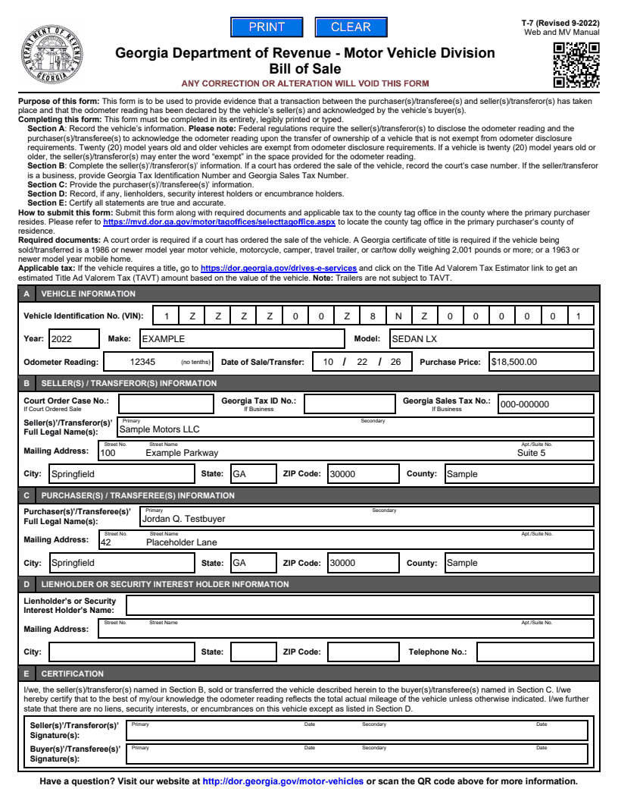
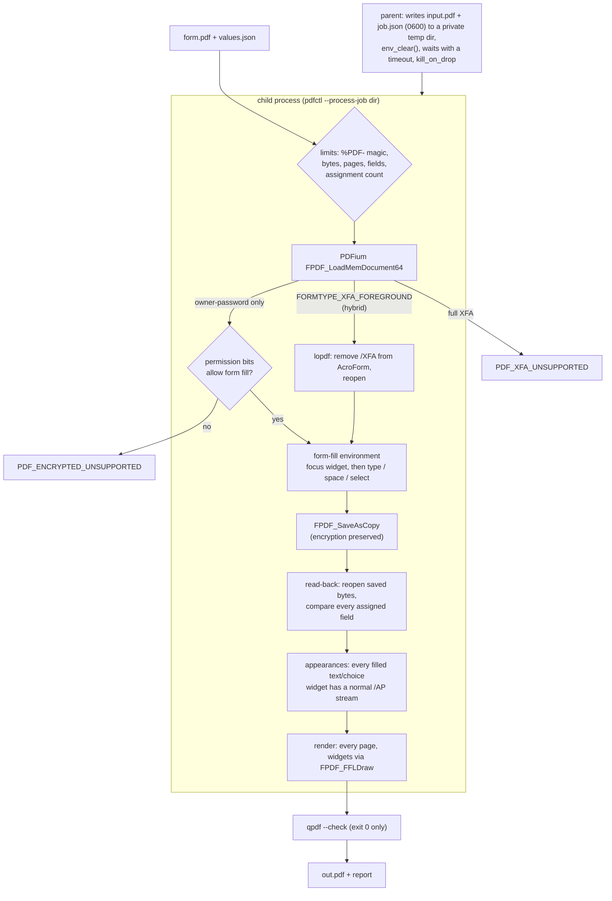

# pdf-form-filler

Fill real-world government PDF forms (owner-password encrypted, hybrid XFA, comb fields, radio groups) with PDFium the way a person in a browser would, prove every value landed, and keep a hostile template from taking the process down.



## Why this exists

A dealership management platform has to produce state title paperwork (title applications, bills of sale, powers of attorney) and the FTC Buyers Guide for every deal. The first version used pdf-lib, which could not open the owner-password-encrypted state forms at all. It wrote values without regenerating appearances, so some viewers showed blank boxes, and on the FTC's hybrid XFA form Acrobat displayed stale XFA data instead of the filled fields. This crate is the Rust replacement extracted from that production system. It fills through PDFium's form-fill environment, verifies its output four ways, and runs each job in a child process with a kill timeout.

## Architecture



| Path | What it is |
| --- | --- |
| `src/pdf/engine.rs` | A small safe wrapper over PDFium's C API: load from memory, permission and form-type checks, widget enumeration, set text/press/select through the form-fill environment, save, render. |
| `src/pdf/fill.rs` | `inspect` and `fill`: limits, unique assignments, missing/unsupported field policies, value coercion, and post-save read-back. |
| `src/pdf/xfa.rs` | Strips the XFA layer from hybrid forms with lopdf, since PDFium cannot edit objects. |
| `src/job_process.rs` | The child-process boundary: private temp dir, clean environment, timeout, crash detection, one JSON line back. |
| `src/verify.rs` | Post-fill gate on a saved file: read-back, appearance streams, `qpdf --check`, render every page. |
| `src/signing.rs` | HMAC-SHA256 request signing (feature `signing`, on by default), for a service that receives jobs over HTTP. |
| `src/bin/pdfctl.rs` | CLI: `inspect`, `fill`, `verify`, `render`. |

**Design decisions and tradeoffs**

- **Fill like a user, not like an object editor.** pdfium-render's high-level setters write `/V` on a widget and leave appearance streams alone. That breaks fields with several widgets, and checkboxes whose "on" state is not called `/Yes` (the FTC guide's is `/As Is`). Instead, the engine focuses each widget and calls `FORM_ReplaceSelection`, `FORM_OnChar(space)` or `FORM_SetIndexSelected`, exactly what Chrome's viewer does. PDFium then stores the value on the field, applies `/MaxLen` and comb rules, and regenerates every widget's appearance itself. The cost is more FFI surface and a hard dependency on the form-fill environment being initialised.
- **Owner-password forms are filled, not decrypted.** Georgia's MV-1, T-7 and T-8 are AES-encrypted with an owner password only. They open without a password, and their permission bits say whether filling is allowed. The engine honours those bits and saves with encryption intact, so the issuer's restrictions survive. pdf-lib could not read these files at all.
- **Hybrid XFA: one source of truth.** If a hybrid form is filled through its AcroForm alone, the stale XFA packet still wins in Adobe Reader. So the `/XFA` entry is removed with lopdf (the one step PDFium cannot do), the result is held to the same input limit, and PDFium reopens it. Pure XFA forms have no AcroForm to fill and are refused, as are encrypted hybrids (rewriting them would drop the encryption).
- **Fail closed, by default.** A name that does not exist is `PDF_FIELD_MISSING`, and a signature or push button is `PDF_FIELD_UNSUPPORTED`, unless the caller opts into `--skip-missing` / `--skip-unsupported`. A value too long for `/MaxLen` is not silently truncated: PDFium truncates it while typing, read-back notices, and the fill fails with `PDF_READBACK_FAILED`. A radio group that already has a selection cannot be "cleared", because no person filling the form could do that either.
- **Verify the bytes that will ship, not the in-memory document.** After saving, the output is reopened from bytes and every assignment is read back. Every filled text or choice widget must have a normal appearance stream, every page is rendered with its widgets drawn (`FPDF_FFLDraw`, since `FPDF_RenderPageBitmap` deliberately skips them), and `qpdf --check` must exit 0. The original government files fail that check, because qpdf exits 3 on their stale linearization hints. PDFium's full rewrite fixes them, so a warning on our own output means something actually went wrong.
- **One job, one process.** PDFium calls cannot be interrupted, and the library is process-global and not thread-safe. A template that loops, exhausts memory or segfaults would take a thread-based worker with it, and a timeout on a thread only stops waiting. Each job runs in `pdfctl --process-job <dir>`. The parent writes inputs with mode 0600, clears the environment (the child never sees the parent's secrets), and kills the child at the deadline (`kill_on_drop`). A crash or garbage on stdout becomes `Crashed` for that job alone. The price is a process spawn plus a PDFium load per job, about 20 ms here (47 ms in-process vs. 69 ms isolated for the T-8), which is small next to a multi-page render.
- **Errors carry names and counts, never values.** Reports and error details list field names, types, limits and counts. Filled forms hold names, addresses and VINs, and none of that may end up in logs.

## Quick start

Needs Rust 1.89+, curl and qpdf (`apt install qpdf` / `brew install qpdf`).

```bash
scripts/fetch-pdfium.sh                       # PDFium build 7881 into ./.pdfium, checksum-verified
export PDFIUM_DYNAMIC_LIB_PATH=$PWD/.pdfium/lib
cargo build

cargo run -q -- fill --form fixtures/forms/ga-t7-bill-of-sale.pdf \
                     --data examples/ga-t7-bill-of-sale.json --out out.pdf
cargo run -q -- verify out.pdf --data examples/ga-t7-bill-of-sale.json
cargo run -q -- render out.pdf 1 page1.png
```

`fill` prints the report (names and counts only):

```json
{ "pageCount": 1, "fieldCount": 48, "filled": [ ...25 fields... ], "skipped": [],
  "outputBytes": 245418, "editable": true, "readBackVerified": true }
```

`verify` re-checks the saved file independently:

```json
{ "pageCount": 1, "pagesRendered": 1, "fieldCount": 48, "fieldsWithValues": 25,
  "widgetsWithAppearance": 25, "readBackVerified": 25, "structure": "passed" }
```

More to try:

```bash
# Hybrid XFA form: XFA layer removed, AcroForm filled (page 1 shown below)
cargo run -q -- fill --form fixtures/forms/ftc-buyers-guide.pdf --data examples/ftc-buyers-guide.json --out guide.pdf

# Owner-password-encrypted, two pages, text + checkboxes + radio groups
cargo run -q -- fill --form fixtures/forms/ga-mv1-title-application.pdf --data examples/ga-mv1-title-application.json --out mv1.pdf

# The same fill isolated in a child process, then one that is killed at 1 ms
cargo run -q -- fill --isolate --form fixtures/forms/ga-t7-bill-of-sale.pdf --data examples/ga-t7-bill-of-sale.json --out out.pdf
cargo run -q -- fill --timeout-ms 1 --form fixtures/forms/ga-t7-bill-of-sale.pdf --data examples/ga-t7-bill-of-sale.json --out out.pdf
# PDF processing timed out

# Every field, its type, widget count, flags and options
cargo run -q -- inspect fixtures/forms/ga-t8-limited-power-of-attorney.pdf
```

`values.json` maps field names (as `inspect` prints them) to a string, a boolean (checkboxes), a string array (list boxes) or `null`. Keys starting with `$` are ignored. The array form `[{"name": ..., "value": ...}]` also works. All values in `examples/` are synthetic.


### Docker

The image bundles the pinned PDFium and qpdf and runs as a non-root user:

```bash
docker build -t pdf-form-filler .
mkdir -p out && chmod 777 out       # the image runs as uid 65532
docker run --rm -v "$PWD:/work:ro" -v "$PWD/out:/out" pdf-form-filler \
  fill --isolate --form /work/fixtures/forms/ga-t7-bill-of-sale.pdf --data /work/examples/ga-t7-bill-of-sale.json --out /out/out.pdf
docker run --rm -v "$PWD/out:/out:ro" pdf-form-filler verify /out/out.pdf
docker build --target test .        # full test suite against the bundled PDFium (about 3 GB of build cache)
```

### As a library

```rust
use pdf_form_filler::pdf::{self, Assignment, Engine, FillOptions, Value};

let engine = Engine::load(&pdf::default_library_path())?;
let assignments = vec![Assignment { name: "VIN".into(), value: Value::Text("1ZZZZ00Z8NZ000001".into()) }];
let (bytes, report) = pdf::fill(&engine, std::fs::read("form.pdf")?, &assignments, &FillOptions::default())?;
```

For untrusted templates, call `job_process::process(exe, pdfium_dir, &input, &assignments, limits, timeout)` from a binary whose `main` hands `--process-job <dir>` to `job_process::serve` (as `pdfctl` does).

## Tests

```bash
export PDFIUM_DYNAMIC_LIB_PATH=$PWD/.pdfium/lib
REQUIRE_PDFIUM=1 cargo test
```

```
test result: ok. 12 passed   (unit: coercion, limits, error codes, XFA stripping, HMAC)
test result: ok. 10 passed   (tests/forms.rs: the form corpus)
test result: ok. 6 passed    (tests/process.rs: the child-process boundary)
```

Without PDFium the corpus and child-PDF tests print `skipping` and pass, so `cargo test` still runs the unit tests on any machine. `REQUIRE_PDFIUM=1` (set in CI and in the Docker test stage) turns a missing library into a failure.

What they prove:

- **Every fillable form in the corpus** (MV-1, T-7, T-8, FTC Buyers Guide) gets a value in every fillable field, reads back exactly, passes `qpdf --check`, and renders every page.
- **Owner-password encryption** is detected and preserved through the fill. **Hybrid XFA** is stripped (the `/XFA` key is gone from the output) and filled.
- **Fail-closed rules**: a missing field errors (and can be skipped by policy), an 18-character value in the T-7's 17-cell comb VIN field is refused rather than truncated, wrong value types and push buttons are refused, duplicate names are rejected, and limits apply before parsing. Error text never contains a value.
- **Verification**: `verify` reports what it checked and fails read-back against values the file does not hold. qpdf accepts a fresh save, rejects a truncated file, and rejects the issuer's original (exit 3) by design.
- **Process isolation**: a real fill round-trips through the child, a PDF error comes back with its code, and a 1 ms deadline kills the job. With stand-in child scripts (no PDFium needed): a hung child is killed in well under the 30 s it asked for, a `SIGSEGV` or non-JSON child is reported as `Crashed`, and the child sees an empty environment apart from the PDFium path.
- **Signing**: the HMAC matches an independent Python `hmac`/`hashlib` reference (which also reproduces the original TypeScript signer's vector), changes when any signed component changes, and `verify` rejects tampering in constant time.

## What was left out

In production this library sat inside a worker service. That service leased jobs from a control plane over signed HTTP, downloaded templates from and uploaded results to pre-signed storage URLs restricted to an origin allowlist, heartbeated, and reported retryable vs. permanent failures. That job protocol, its configuration and its HTTP/storage glue are product-specific and were dropped. The request signer is kept as a standalone module. The product's mapping from deal records to form fields, and the dealer-specific templates, are not included. The fixtures are only blank public government forms.

PDFium is BSD-3-Clause (license shipped in `.pdfium/LICENSE` by the fetch script and in the Docker image). This crate is MIT.
